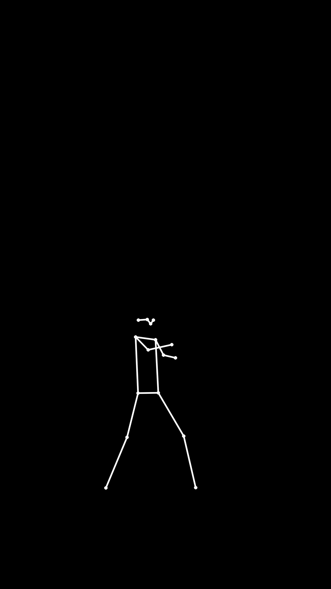

# Human Pose Estimation Using YOLO and OpenCV

<p align="center">
  <b>Computer Vision Project | Human Movement and Pose Detection</b>
</p>

<p align="center">
  
</p>

## 📌 Project Overview

Human Pose Estimation is a Computer Vision technique used to identify and locate important body joints and keypoints in images and videos.

This project implements human pose estimation on a video containing human movement using **YOLO Pose and OpenCV**.

The system detects 17 human body keypoints based on the COCO format and connects them to generate a skeletal representation of the human body.

The original video frame is replaced with a completely black background displaying only white dots representing body joints and white lines connecting them.

This allows human movement to be visualized without displaying the person's actual appearance.

## 🎯 Project Objectives

- Perform human pose estimation on a video containing human movement.
- Detect 17 human body keypoints using the COCO format.
- Identify important body joints such as shoulders, elbows, wrists, hips, knees, and ankles.
- Extract keypoint coordinates and confidence scores.
- Connect detected keypoints to generate a human skeleton.
- Replace the original video background with a black background.
- Display only white keypoints and connecting lines.
- Generate and save a skeleton-only output video.

## 🛠️ Technologies Used

| Technology | Purpose |
|---|---|
| Python | Main programming language |
| YOLO Pose (Ultralytics) | Human pose detection |
| OpenCV | Video processing and skeleton visualization |
| NumPy | Numerical operations and black-frame generation |
| COCO Dataset | Standard 17-keypoint human pose format |

## 🧠 COCO 17 Keypoints

The project uses the COCO human pose estimation format, which consists of 17 body keypoints.

| Index | Body Part |
|---|---|
| 0 | Nose |
| 1 | Left Eye |
| 2 | Right Eye |
| 3 | Left Ear |
| 4 | Right Ear |
| 5 | Left Shoulder |
| 6 | Right Shoulder |
| 7 | Left Elbow |
| 8 | Right Elbow |
| 9 | Left Wrist |
| 10 | Right Wrist |
| 11 | Left Hip |
| 12 | Right Hip |
| 13 | Left Knee |
| 14 | Right Knee |
| 15 | Left Ankle |
| 16 | Right Ankle |

Each detected keypoint contains:
- X-coordinate
- Y-coordinate
- Confidence score

The confidence score indicates how certain the model is about the detected body joint.

## ⚙️ Project Methodology

### 1. Video Input
A video containing a person performing dancing movements or other physical activities is provided as input.

### 2. Pose Detection
The pretrained YOLO Pose model processes the video frames and identifies human body keypoints.

### 3. Keypoint Extraction
The system extracts the coordinates and confidence scores of the 17 COCO keypoints for each detected person.

### 4. Confidence Filtering
A confidence threshold is applied to filter out keypoints with low detection confidence.

### 5. Skeleton Generation
OpenCV connects detected body joints using white lines and represents individual joints using white circles.

### 6. Background Replacement
A new black frame is generated for every input frame. The original person and background are not displayed in the output.

### 7. Video Generation
All processed frames are combined into a video while maintaining the original frame rate and resolution.

## 🔄 Project Workflow

```text
       Input Video
            |
            v
    Video Frame Extraction
            |
            v
     YOLO Pose Detection
            |
            v
   COCO 17 Keypoint Extraction
            |
            v
    Confidence Filtering
            |
            v
     Skeleton Generation
            |
            v
    Black Background Creation
            |
            v
    White Dots and Lines
            |
            v
     Processed Video Output
```

## 📂 Repository Structure

```text
human_pose_estimation/
│
├── input/
│   ├── dance.mp4
│   └── .gitkeep
│
├── output/
│   ├── skeleton_output.mp4
│   └── .gitkeep
│
├── results/
│   ├── skeleton_preview.png
│   └── .gitkeep
│
├── main.py
├── requirements.txt
├── README.md
└── .gitignore
```

## 🚀 Installation and Setup

### Prerequisites

- Python 3.9 or later
- Git
- Visual Studio Code (recommended)
- Internet connection for downloading the pretrained YOLO model

### Step 1: Clone the Repository

```bash
git clone https://github.com/chetnagurjar/human_pose_estimation.git
```

### Step 2: Navigate to the Project Directory

```bash
cd human_pose_estimation
```

### Step 3: Install Dependencies

```bash
pip install -r requirements.txt
```

### Step 4: Add the Input Video

Place your dancing or movement video inside the `input` folder.

Rename it:

```text
dance.mp4
```

### Step 5: Run the Program

```bash
python main.py
```

The pretrained YOLO Pose model (`yolo11n-pose.pt`) will be downloaded automatically when required.

## 📊 Project Results

### Skeleton Visualization

The following image demonstrates the output generated by the pose estimation system.


The visualization contains:

- Completely black background.
- White dots representing detected body joints.
- White lines connecting the detected keypoints.
- No original person or video background.

### 🎬 Final Output Video

The complete processed video is available directly in this repository.

**[▶ View / Download Skeleton Output Video](output/skeleton_output.mp4)**

The video demonstrates human pose estimation using YOLO Pose, with 17 COCO keypoints represented as white dots and connecting lines on a black background.

## 💡 Applications

Human Pose Estimation can be used in several practical applications:

- Dance movement analysis.
- Fitness and exercise tracking.
- Sports performance analysis.
- Human activity recognition.
- Gesture recognition.
- Motion analysis.
- Animation and motion capture.

## 📚 References

- [Ultralytics YOLO Documentation](https://docs.ultralytics.com/)
- [OpenCV Documentation](https://docs.opencv.org/)
- [COCO Dataset](https://cocodataset.org/)


<p align="center">
  <b>Human Pose Estimation | Computer Vision | YOLO | OpenCV</b>
</p>
